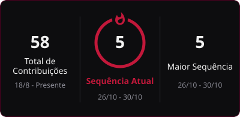

<!--
  README do perfil — João Vitor Rocha Maciel
  Tema: Burgundy Hacker · paleta #800020 #4A001F #0D0D0F #25252B #F1F1F1 #C2183A

  Procure por "PERSONALIZE" para encontrar tudo o que ainda precisa ser preenchido.
  Arquivos do tema:
    assets/banner.svg           cabeçalho (gerado por assets/src/generate_banner.py)
    assets/divider.svg          divisor entre seções
    assets/footer.svg           rodapé binário
    assets/icons/               ícones locais (Canva e infraestrutura)
    profile/                    cards de estatísticas (gerados pelo GitHub Actions)
-->

<div align="center">



<br>

**Estudante de Tecnologia da Informação, explorando diferentes áreas da tecnologia, desenvolvendo minhas habilidades e construindo meu caminho profissional.**

</div>


### `0x01` Sobre mim

Minha base em TI começou pelo funcionamento das máquinas — hardware, software e redes — e é dela que vem o meu jeito de aprender: entender a camada de baixo antes de construir a de cima.

Ainda estou descobrindo onde quero me aprofundar, e encaro isso como parte do processo: experimentar, praticar e conectar áreas diferentes. Este GitHub é o registro dessa evolução.

**Formação**

- **Ensino Médio Técnico** — Escola Maria Nilde · São Bernardo do Campo
- **Técnico em Informática** — Senac São Bernardo do Campo


### `0x02` Interesses em tecnologia

As áreas que guiam meus estudos hoje:

```text
$ ls ~/interesses
desenvolvimento/   linux/   redes/
infraestrutura/    cybersecurity/

$ echo $MODO
aprendizado contínuo
```


### `0x03` Tecnologias e ferramentas

Ferramentas que uso nos estudos — cada uma em um estágio diferente de prática.

<!-- Ícones do skillicons.dev: para adicionar ou remover, edite a lista depois de "i=".
     Lista de nomes disponíveis: https://github.com/tandpfun/skill-icons#icons-list -->

**Linguagens**<br>
<br>
<sub>Python · C# · JavaScript · HTML · CSS</sub>

**Frameworks, bibliotecas e banco de dados**<br>
<br>
<sub>React · Bootstrap · MySQL</sub>

**Ferramentas de desenvolvimento**<br>
<br>
<sub>Git · GitHub · Visual Studio · VS Code · Canva</sub>

**Infraestrutura**<br>
<br>
<sub>Linux · Redes de computadores · Hardware · Infraestrutura de TI</sub>


### `0x04` Estatísticas do GitHub

<!-- Os cards abaixo são gerados todos os dias pelo workflow .github/workflows/profile-cards.yml
     a partir dos dados públicos da conta. Para mudar cores ou opções, edite esse arquivo. -->

<div align="center">



<br>

<br>


<sub>Dados reais da conta, atualizados diariamente pelo GitHub Actions.</sub>

</div>


### `0x05` Contato


<!-- PERSONALIZE: troque os links. No e-mail, mantenha o "mailto:" antes do endereço.
     Se não tiver portfólio, apague o badge inteiro (do <a> até o </a>).
     Outras redes prontas para usar (copie para a linha de badges):
     <a href="https://tryhackme.com/p/SEU-USUARIO"></a>
     <a href="https://app.hackthebox.com/profile/SEU-ID"></a>
     <a href="https://www.instagram.com/SEU-USUARIO"></a> -->

<a href="https://www.linkedin.com/in/SEU-PERFIL"></a>
<a href="mailto:SEU-EMAIL@DOMINIO.COM"></a>
<a href="https://SEU-PORTFOLIO.COM"></a>

<br>

<div align="center">

</div>
